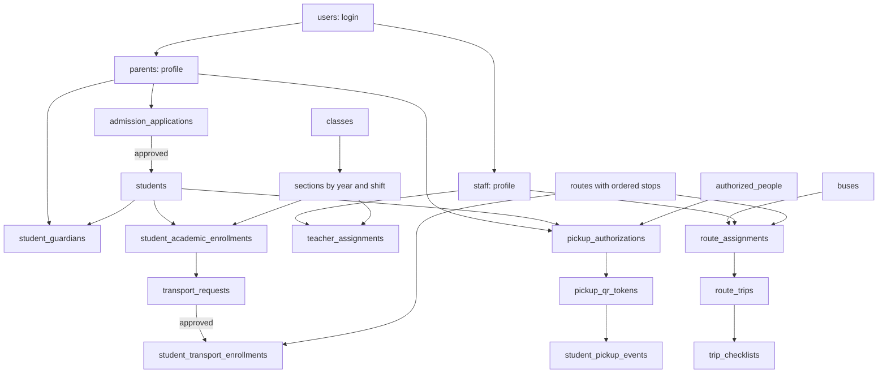

# School ERP Database Plan

**Status: Database design approved by you on 2026-10-18.**

This plan covers parent registration, child admission, school staff, classes, and optional school transport. It also includes the manual trip, checklist, and safe child handover features from the existing learning plan.

Read [the simple project overview](SCHOOL_ERP_PROJECT_OVERVIEW.md) first. This document explains what we will store in MongoDB. The proposed [API List](SCHOOL_ERP_API_LIST.md) and [API Examples](SCHOOL_ERP_API_EXAMPLES.md) use this approved design and are ready for review. These are planning documents; this documentation work does not implement collections or API endpoints.

## 1. Scope of this approved plan

- A parent can create an account and apply for admission for one or more children.
- School staff review each application. Approval creates the child's student record and class placement.
- A parent can request transport after admission. Transport is optional.
- The school can register teachers, drivers, bus attendants (bus didi), gatekeepers, and office staff.
- The school can manage buses, stops, routes, seat allocation, and date-based staff assignments.
- Staff can record trip start/end, complete checklists, and record a safe handover to an approved person.
- There is no GPS, live bus location, map, ETA, geofence, or automatic movement log.
- Fees, online payments, exams, homework, payroll, library, and full school attendance are future modules. No collections for them are included here.

Here, **complete** means complete for this agreed feature area. It does not mean every possible School ERP module.

## 2. Simple database words

| Word            | Simple meaning                                                                          |
| --------------- | --------------------------------------------------------------------------------------- |
| Database        | The main place where the project saves data. Suggested name: `school_erp`.              |
| Collection      | A group of similar records. Example: `students`.                                        |
| Document        | One record in a collection. Example: one child's student record.                        |
| Key or field    | One detail in a document. Example: `full_name`.                                         |
| Value           | The saved detail. Example: `Aarav Sharma`.                                              |
| ObjectId        | MongoDB's ID for a document.                                                            |
| Reference       | An ID that connects one document to another.                                            |
| Embedded object | Small related details saved inside a document, such as an address.                      |
| Array           | A list of values or objects, such as a route's ordered stops.                           |
| Index           | A database helper for finding records quickly. A unique index also prevents duplicates. |
| Transaction     | A group of changes that all succeed together or all fail together.                      |

## 3. How to read the field tables

Every collection below has its own table: **key, type, sample value, and information**.

- Fields are required unless the information says **optional** or gives a condition.
- `String` means text. `Integer` means a whole number. `Boolean` means `true` or `false`.
- `Date` means a MongoDB BSON Date, stored as a UTC time. A sample ending in `Z` shows UTC.
- `DateOnly` means a string in `YYYY-MM-DD` format. Use it for birthdays and school calendar dates.
- `Time` means local school time in `HH:mm`, using the school's `timezone`.
- For effective periods, `valid_from` is included and `valid_to` is excluded. Example: `2026-06-01` to `2026-07-01` includes June, but not July 1. Year `ends_on` is the last included calendar day.
- Optional values should be absent when unknown. A table sample of `omitted` is an explanation, not a stored string.
- Table rows show possible field values across workflow stages. They are not one ready-to-insert document: for example, an unreviewed application does not yet have its review or approval fields.
- `address.city` means the `city` key inside an `address` object. `stops[].stop_id` means a key inside each object in the `stops` array.
- Array item fields are required when an item exists, unless marked optional. Empty lists are allowed only where the rules below permit them.

### Friendly IDs used in samples

To keep tables easy to read, `@school`, `@parent`, and similar labels stand for real ObjectIds. **Do not store these labels as strings.** For example, `@school` can stand for `ObjectId("660000000000000000000001")`.

| Sample label                                                      | Points to                                                 |
| ----------------------------------------------------------------- | --------------------------------------------------------- |
| `@school`, `@year`, `@shift`                                      | One school, academic year, and school shift               |
| `@parentUser`, `@adminUser`, `@driverUser`, `@attendantUser`      | Login records in `users`                                  |
| `@parent`, `@student`, `@guardianLink`                            | Parent, child, and their verified relationship            |
| `@teacher`, `@driver`, `@attendant`, `@gatekeeper`, `@adminStaff` | Records in `staff`                                        |
| `@class`, `@section`, `@academicEnrollment`                       | Class 1, section A, and the child's placement             |
| `@application`                                                    | Admission application                                     |
| `@bus`, `@stop`, `@schoolGate`, `@route`, `@assignment`           | Bus, two stops, route, and its bus/staff assignment       |
| `@transportRequest`, `@transportEnrollment`                       | Parent request and approved seat allocation               |
| `@template`, `@trip`, `@person`, `@authorization`, `@token`       | Checklist, trip, pickup person, permission, and QR record |

All names, addresses, registration numbers, and contacts are fictional samples.

### Common fields in every collection

The following fields are part of each collection's schema. They are listed once to avoid repeating the same rows 28 times.

| Key          | Type     | Sample value                           | Information                                                                                          |
| ------------ | -------- | -------------------------------------- | ---------------------------------------------------------------------------------------------------- |
| `_id`        | ObjectId | `ObjectId("660000000000000000000001")` | Unique ID of this document. Created by the database/application.                                     |
| `school_id`  | ObjectId | `@school`                              | School that owns the record. Required everywhere except `schools`; there, `_id` is the school ID.    |
| `created_at` | Date     | `2026-06-01T04:30:00Z`                 | When this record was created. Server sets this.                                                      |
| `updated_at` | Date     | `2026-06-02T05:00:00Z`                 | Most recent change. Server sets this. Not used on immutable `audit_logs` or `student_pickup_events`. |

Every reference must point to a record in the same school. MongoDB does not enforce these links like SQL foreign keys; the application must check them. A parent cannot select another school ID to gain access to its records.

## 4. Collection sequence

This is the reading and setup sequence. Some daily actions use several collections together.

| No. | Collection name                 | One document means                                    |
| --- | ------------------------------- | ----------------------------------------------------- |
| 01  | `schools`                       | One school                                            |
| 02  | `academic_years`                | One school year                                       |
| 03  | `shifts`                        | One school session                                    |
| 04  | `users`                         | One login account                                     |
| 05  | `parents`                       | One parent or guardian profile                        |
| 06  | `staff`                         | One school employee                                   |
| 07  | `classes`                       | One class level, such as Class 1                      |
| 08  | `sections`                      | One class group in one school year                    |
| 09  | `teacher_assignments`           | One teacher's dated class responsibility              |
| 10  | `admission_applications`        | One child's admission request                         |
| 11  | `students`                      | One admitted child                                    |
| 12  | `student_guardians`             | One verified parent-child relationship                |
| 13  | `student_academic_enrollments`  | One child's dated class placement                     |
| 14  | `buses`                         | One bus                                               |
| 15  | `stops`                         | One named stop or school gate                         |
| 16  | `routes`                        | One route version for one year and travel direction   |
| 17  | `route_assignments`             | One route's bus and crew for a date period            |
| 18  | `transport_requests`            | One parent's transport request for one child          |
| 19  | `student_transport_enrollments` | One child's approved route and stop for one direction |
| 20  | `checklist_templates`           | One version of a reusable checklist                   |
| 21  | `route_trips`                   | One route's run on one date                           |
| 22  | `trip_checklists`               | One completed checklist for one trip                  |
| 23  | `authorized_people`             | One adult whose identity can be checked at handover   |
| 24  | `pickup_authorizations`         | One child's permission to leave with one person       |
| 25  | `pickup_qr_tokens`              | One short-lived QR permission token                   |
| 26  | `student_pickup_events`         | One successful or denied child handover attempt       |
| 27  | `transport_settings`            | One school's transport rules                          |
| 28  | `audit_logs`                    | One important change made by a user or system         |

Collections 01-19 are the main admission and transport-allocation design. Collections 20-26 cover daily operations from the old plan. Settings and audit apply across the project from the start.

## 5. Collection details

### 01. `schools`

**Purpose:** Store the basic school details. Created by the initial school setup process.

| Key                   | Type    | Sample value             | Information                                                                                 |
| --------------------- | ------- | ------------------------ | ------------------------------------------------------------------------------------------- |
| `code`                | String  | `SUNRISE01`              | Unique school code.                                                                         |
| `name`                | String  | `Sunrise Public School`  | School name.                                                                                |
| `phone`               | String  | `+910000000001`          | School contact number. Keep as text, not a number.                                          |
| `email`               | String  | `office@sunrise.example` | School contact email.                                                                       |
| `address.line1`       | String  | `12 School Road`         | Street address.                                                                             |
| `address.city`        | String  | `Pune`                   | City.                                                                                       |
| `address.state`       | String  | `Maharashtra`            | State.                                                                                      |
| `address.postal_code` | String  | `411001`                 | Postal code.                                                                                |
| `address.country`     | String  | `IN`                     | Country code.                                                                               |
| `timezone`            | String  | `Asia/Kolkata`           | Timezone used for school dates and schedules.                                               |
| `status`              | String  | `active`                 | `active` or `inactive`.                                                                     |
| `ac_year`             | String  |                          | or .                                                                                        |
| `allocation_version`  | Integer | `0`                      | Internal counter used to keep simultaneous seat and assignment changes safe. See section 9. |

**Rules:** Start with one school. Keep school boundaries in the design so another school can be added later. Each user account belongs to one school in this version. The initial admin account is created by setup, not public parent registration.

### 02. `academic_years`

**Purpose:** Keep records separated by school year.

| Key          | Type     | Sample value | Information                              |
| ------------ | -------- | ------------ | ---------------------------------------- |
| `name`       | String   | `2026-2027`  | Name shown to people.                    |
| `starts_on`  | DateOnly | `2026-04-01` | First day of the year.                   |
| `ends_on`    | DateOnly | `2027-03-31` | Last included day of the year.           |
| `is_current` | Boolean  | `true`       | Whether this is the current school year. |
| `status`     | String   | `active`     | `planned`, `active`, or `closed`.        |

**Rules:** Only one year can be current per school. Changing the current year does not move students automatically. Old years remain available for history.

### 03. `shifts`

**Purpose:** Describe when a group of students attends school.

| Key         | Type   | Sample value | Information             |
| ----------- | ------ | ------------ | ----------------------- |
| `name`      | String | `Day School` | Session name.           |
| `starts_at` | Time   | `08:30`      | School start time.      |
| `ends_at`   | Time   | `15:00`      | School end time.        |
| `status`    | String | `active`     | `active` or `inactive`. |

**Rules:** A school shift is different from a travel direction. One day-school shift can have a morning journey to school and an afternoon journey home. Overnight sessions are outside this version. Once used by a section or route, preserve its start/end times. A schedule change creates a new shift record with a distinct name and new future section/route references.

### 04. `users`

**Purpose:** Store login details and access roles. A login is different from a person's parent or staff profile.

| Key             | Type     | Sample value           | Information                                                                           |
| --------------- | -------- | ---------------------- | ------------------------------------------------------------------------------------- |
| `email`         | String   | `meera@example.com`    | Login email, trimmed and saved in lowercase.                                          |
| `password_hash` | String   | `<password hash>`      | Secure password hash. Never save the actual password. This sample is not a real hash. |
| `roles`         | String[] | `["parent"]`           | Allowed access roles listed below.                                                    |
| `status`        | String   | `active`               | `active`, `blocked`, or `inactive`.                                                   |
| `last_login_at` | Date     | `2026-06-01T04:30:00Z` | Optional. Last successful login.                                                      |

**Roles:** `school_admin`, `admission_officer`, `transport_admin`, `teacher`, `driver`, `attendant`, `gatekeeper`, `parent`.

**Rules:** Public registration gives only the `parent` role. Only a permitted school admin can give staff roles. A teacher who is also a parent can have one login linked to both profiles. Login email is unique within a school. A child's login is not needed in this version. Never return password hashes in normal responses, reports, or logs. Login/session implementation will be decided later.

### 05. `parents`

**Purpose:** Store a parent's or guardian's personal contact details.

| Key                   | Type     | Sample value         | Information                                                                              |
| --------------------- | -------- | -------------------- | ---------------------------------------------------------------------------------------- |
| `user_id`             | ObjectId | `@parentUser`        | Optional for an offline guardian; required for a parent using the app. Links to `users`. |
| `full_name`           | String   | `Meera Sharma`       | Parent's name.                                                                           |
| `phone`               | String   | `+910000000002`      | Main contact number, normalized with country code.                                       |
| `alternate_phone`     | String   | `+910000000003`      | Optional. Another contact number.                                                        |
| `address.line1`       | String   | `24 Green Park Road` | Home address.                                                                            |
| `address.city`        | String   | `Pune`               | City.                                                                                    |
| `address.state`       | String   | `Maharashtra`        | State.                                                                                   |
| `address.postal_code` | String   | `411001`             | Postal code.                                                                             |
| `address.country`     | String   | `IN`                 | Country code.                                                                            |
| `status`              | String   | `active`             | `active` or `inactive`.                                                                  |

**Rules:** Registration creates `users` and `parents` together. Do not keep a second child list here; use `student_guardians`. Do not use a shared phone number as proof that two records are the same person. Login email comes from `users`.

### 06. `staff`

**Purpose:** Register teachers, drivers, attendants, gatekeepers, and office staff.

| Key                               | Type     | Sample value    | Information                                                                                                                   |
| --------------------------------- | -------- | --------------- | ----------------------------------------------------------------------------------------------------------------------------- |
| `user_id`                         | ObjectId | `@driverUser`   | Optional until login is needed. A staff member recording actions must have an active login.                                   |
| `employee_code`                   | String   | `EMP-0007`      | Employee number, unique in the school.                                                                                        |
| `full_name`                       | String   | `Ramesh Patil`  | Staff name.                                                                                                                   |
| `phone`                           | String   | `+910000000004` | Contact number.                                                                                                               |
| `job_roles`                       | String[] | `["driver"]`    | Jobs: `teacher`, `driver`, `attendant`, `gatekeeper`, `office_staff`, `school_admin`, `admission_officer`, `transport_admin`. |
| `joined_on`                       | DateOnly | `2026-04-01`    | Joining date.                                                                                                                 |
| `left_on`                         | DateOnly | `omitted`       | Optional. Last employment day.                                                                                                |
| `driver_details.license_number`   | String   | `DEMO-LIC-0007` | Required for a driver. Restricted staff information.                                                                          |
| `driver_details.license_valid_to` | DateOnly | `2028-03-31`    | Required for a driver. Last valid day.                                                                                        |
| `status`                          | String   | `active`        | `active`, `on_leave`, or `inactive`.                                                                                          |

**Rules:** Teachers and drivers use the same collection. A bus attendant is a staff member, not a separate account type or collection. `job_roles` describe work; `users.roles` control app access. Permission checks need both a permitted login and a valid staff assignment. A role change must not silently leave an invalid active assignment.

### 07. `classes`

**Purpose:** Store class levels that can be reused each year.

| Key          | Type    | Sample value | Information                          |
| ------------ | ------- | ------------ | ------------------------------------ |
| `code`       | String  | `CLASS-1`    | Unique class code within the school. |
| `name`       | String  | `Class 1`    | Display name.                        |
| `sort_order` | Integer | `1`          | Order for showing class levels.      |
| `status`     | String  | `active`     | `active` or `inactive`.              |

**Rules:** A class is a level. A section is a group within that level. Subjects and lesson timetables are future scope.

### 08. `sections`

**Purpose:** Store class groups for a particular year and school shift.

| Key                | Type     | Sample value | Information                       |
| ------------------ | -------- | ------------ | --------------------------------- |
| `academic_year_id` | ObjectId | `@year`      | Links to `academic_years`.        |
| `class_id`         | ObjectId | `@class`     | Links to `classes`.               |
| `shift_id`         | ObjectId | `@shift`     | Links to `shifts`.                |
| `name`             | String   | `A`          | Section name, such as A or B.     |
| `capacity`         | Integer  | `40`         | Maximum students in this section. |
| `status`           | String   | `active`     | `active` or `inactive`.           |

**Rules:** Class 1-A in 2026-2027 and Class 1-A in 2027-2028 are different documents. Capacity must be positive. Do not reduce capacity below existing commitments. Once used, do not change the section's class, year, or shift identity. Create a new section and dated placements for such a change.

### 09. `teacher_assignments`

**Purpose:** Record who is responsible for a section and keep past assignments.

| Key              | Type     | Sample value    | Information                                                          |
| ---------------- | -------- | --------------- | -------------------------------------------------------------------- |
| `staff_id`       | ObjectId | `@teacher`      | Active staff member with the `teacher` job role.                     |
| `section_id`     | ObjectId | `@section`      | Section being taught. Its document gives the year, class, and shift. |
| `responsibility` | String   | `class_teacher` | `class_teacher` or `assistant_teacher`.                              |
| `valid_from`     | DateOnly | `2026-06-01`    | First day of responsibility.                                         |
| `valid_to`       | DateOnly | `2027-04-01`    | First day after responsibility ends.                                 |
| `status`         | String   | `active`        | `active`, `ended`, or `cancelled`.                                   |

**Rules:** Allow only one class teacher per section for an overlapping period. An assistant teacher can support the section. Close the old period and create a new assignment when responsibility changes.

### 10. `admission_applications`

**Purpose:** Keep a child's application before the child becomes an admitted student.

| Key                         | Type     | Sample value                            | Information                                                                                            |
| --------------------------- | -------- | --------------------------------------- | ------------------------------------------------------------------------------------------------------ |
| `application_no`            | String   | `APP-2026-0001`                         | Unique application number within the school.                                                           |
| `parent_id`                 | ObjectId | `@parent`                               | Parent who submitted the application.                                                                  |
| `academic_year_id`          | ObjectId | `@year`                                 | Requested school year.                                                                                 |
| `requested_class_id`        | ObjectId | `@class`                                | Class requested by the parent.                                                                         |
| `requested_shift_id`        | ObjectId | `@shift`                                | School shift requested by the parent.                                                                  |
| `child.full_name`           | String   | `Aarav Sharma`                          | Child's name as submitted.                                                                             |
| `child.date_of_birth`       | DateOnly | `2020-02-10`                            | Child's birth date. Do not store changing age.                                                         |
| `child.gender`              | String   | `omitted`                               | Optional: `female`, `male`, `other`, `prefer_not_to_say`.                                              |
| `relationship_to_child`     | String   | `mother`                                | `mother`, `father`, or `guardian`.                                                                     |
| `transport_interest`        | Boolean  | `true`                                  | Parent is interested in transport. This does not reserve a seat.                                       |
| `previous_school_name`      | String   | `Little Steps Preschool`                | Optional. Previous school.                                                                             |
| `documents`                 | Object[] | `[]`                                    | Optional, small list of submitted file descriptions. Files themselves are not stored in this document. |
| `documents[].document_type` | String   | `birth_certificate`                     | `birth_certificate`, `transfer_certificate`, or `other`.                                               |
| `documents[].storage_key`   | String   | `admissions/app-0001/birth.pdf`         | Private file-storage reference; not a public download URL.                                             |
| `documents[].file_name`     | String   | `birth.pdf`                             | Original display filename.                                                                             |
| `documents[].uploaded_at`   | Date     | `2026-06-01T04:30:00Z`                  | Upload time.                                                                                           |
| `status`                    | String   | `submitted`                             | `draft`, `submitted`, `under_review`, `needs_changes`, `approved`, `rejected`, `withdrawn`.            |
| `submitted_at`              | Date     | `2026-06-01T04:35:00Z`                  | Required after submission. Absent in an unsubmitted draft.                                             |
| `reviewed_by_staff_id`      | ObjectId | `@adminStaff`                           | Required after a review decision. Links to staff with admission permission.                            |
| `reviewed_at`               | Date     | `2026-06-02T05:00:00Z`                  | Required after a review decision.                                                                      |
| `review_note`               | String   | `Please provide the birth certificate.` | Optional; required when asking for changes or rejecting.                                               |
| `approved_section_id`       | ObjectId | `@section`                              | Required only on approval. Staff choose the final section.                                             |
| `student_id`                | ObjectId | `@student`                              | Required only after successful approval. Links to the student created from this application.           |

**Rules:** One application is for one child and one year. A sibling gets a separate application. Parent signup alone does not create a student. A parent may edit a draft or an application needing changes. Staff control review/approval. Approved and rejected applications remain as history. The submitted child details are a historical copy; later student edits do not rewrite this copy.

Approval must create the student, verified parent link, and academic enrollment together. Repeating the same approval must return the same result, not create another student. Names and birth dates are not reliable unique IDs; possible duplicate child applications need a staff check. Existing students move to the next year through academic enrollment, not another new-admission application.

### 11. `students`

**Purpose:** Store the stable identity of an admitted child.

| Key                        | Type     | Sample value    | Information                                                      |
| -------------------------- | -------- | --------------- | ---------------------------------------------------------------- |
| `admission_no`             | String   | `ADM-2026-0012` | Unique student admission number within the school.               |
| `admission_application_id` | ObjectId | `@application`  | Application that created this student. Required in this version. |
| `full_name`                | String   | `Aarav Sharma`  | Current correct name.                                            |
| `date_of_birth`            | DateOnly | `2020-02-10`    | Child's birth date.                                              |
| `gender`                   | String   | `omitted`       | Optional. Same values as the admission application.              |
| `admitted_on`              | DateOnly | `2026-06-02`    | Date the school admitted the child.                              |
| `status`                   | String   | `active`        | `active`, `withdrawn`, or `graduated`.                           |

**Rules:** Keep this document when the child changes class or transport. Class and section belong in academic enrollments. Parents belong in guardian links. Routes belong in transport enrollments. Do not keep competing copies of these relationships on the student.

### 12. `student_guardians`

**Purpose:** Record which parents may access and act for which children.

| Key                    | Type     | Sample value           | Information                                     |
| ---------------------- | -------- | ---------------------- | ----------------------------------------------- |
| `student_id`           | ObjectId | `@student`             | Child in `students`.                            |
| `parent_id`            | ObjectId | `@parent`              | Adult in `parents`.                             |
| `relationship`         | String   | `mother`               | `mother`, `father`, or `guardian`.              |
| `is_primary_contact`   | Boolean  | `true`                 | Main contact for this child.                    |
| `can_manage_transport` | Boolean  | `true`                 | Can request or change transport for this child. |
| `can_authorize_pickup` | Boolean  | `true`                 | Can approve a person to collect this child.     |
| `verified_by_staff_id` | ObjectId | `@adminStaff`          | Staff member who checked the relationship.      |
| `verified_at`          | Date     | `2026-06-02T05:00:00Z` | When verification happened.                     |
| `status`               | String   | `active`               | `active` or `revoked`.                          |

**Rules:** One parent can link to many children. One child can link to several parents. Save each relationship here, not as growing arrays in both profiles. A parent may see a student only through an active verified link. Before admission, the parent sees only their own application. Adding a second guardian requires staff verification; knowing a name, phone number, or admission number is not enough. Revoke a link instead of deleting its history. Reuse the same pair record if access is restored and record changes in audit logs.

### 13. `student_academic_enrollments`

**Purpose:** Store a child's class history, including a section change during a year.

| Key                | Type     | Sample value | Information                                           |
| ------------------ | -------- | ------------ | ----------------------------------------------------- |
| `student_id`       | ObjectId | `@student`   | Child being placed.                                   |
| `academic_year_id` | ObjectId | `@year`      | School year.                                          |
| `section_id`       | ObjectId | `@section`   | Gives the class and school shift.                     |
| `roll_no`          | String   | `12`         | Roll number within this section and effective period. |
| `valid_from`       | DateOnly | `2026-06-02` | First day in this section.                            |
| `valid_to`         | DateOnly | `2027-04-01` | First day after this placement ends.                  |
| `status`           | String   | `active`     | `active`, `completed`, `withdrawn`, or `cancelled`.   |

**Rules:** A student cannot have overlapping class placements. A section cannot assign the same roll number to two students for an overlapping period. Dates must fit the academic year; the section must belong to that year. A section change closes the old placement and creates a new one. Replace affected future transport segments so they reference the new academic placement, even when the shift stays the same; recheck shift, route, and dates. Year rollover creates a new placement; it does not overwrite the old one. Use `cancelled` if a placement never began; keep its proposed dates but exclude it from seat commitments. Use `withdrawn` with a shortened period when a child leaves after the placement began.

### 14. `buses`

**Purpose:** Store the school's bus details. Bus availability comes from dated route assignments.

| Key                   | Type    | Sample value       | Information                                                           |
| --------------------- | ------- | ------------------ | --------------------------------------------------------------------- |
| `bus_code`            | String  | `BUS-01`           | Internal bus ID shown in the school, unique within the school.        |
| `registration_number` | String  | `DEMO-MH-12-001`   | Vehicle registration number, normalized and unique within the school. |
| `bus_type`            | String  | `standard`         | `standard` or `mini`.                                                 |
| `student_capacity`    | Integer | `40`               | Seats available to children; excludes seats for driver and attendant. |
| `chassis_number`      | String  | `DEMO-CHASSIS-001` | Optional. Vehicle chassis number.                                     |
| `status`              | String  | `active`           | `active`, `maintenance`, or `retired`.                                |

**Rules:** Capacity must be positive. Do not save a permanent driver ID or an `is_assigned` flag here. Those change by route, time, and date. A bus in maintenance cannot start a trip. Changing a bus's capacity must recheck every affected booking.

### 15. `stops`

**Purpose:** Store a named place where children board or leave the bus.

| Key         | Type   | Sample value                       | Information                             |
| ----------- | ------ | ---------------------------------- | --------------------------------------- |
| `code`      | String | `STOP-01`                          | Unique stop code within the school.     |
| `name`      | String | `Green Park Gate`                  | Friendly stop name.                     |
| `address`   | String | `Main gate, Green Park Road, Pune` | Text directions.                        |
| `landmark`  | String | `Near the public garden`           | Optional. Helps families find the stop. |
| `zone_name` | String | `East Area`                        | Optional. Useful grouping.              |
| `stop_type` | String | `bus_stop`                         | `bus_stop` or `school_gate`.            |
| `status`    | String | `active`                           | `active` or `inactive`.                 |

**Rules:** Text addresses are enough for this version. No latitude, longitude, maps, or live location is needed. One stop can appear in many routes. Use a code, not the name alone, as its business identity.

### 16. `routes`

**Purpose:** Save an ordered route and its fixed timetable. One route version has one direction.

| Key                      | Type     | Sample value                                                                                                                 | Information                                                                       |
| ------------------------ | -------- | ---------------------------------------------------------------------------------------------------------------------------- | --------------------------------------------------------------------------------- |
| `academic_year_id`       | ObjectId | `@year`                                                                                                                      | Year in which this route is used.                                                 |
| `shift_id`               | ObjectId | `@shift`                                                                                                                     | School session served by this route.                                              |
| `route_code`             | String   | `EAST-IN`                                                                                                                    | Business route code, reused for versions of the same route.                       |
| `version`                | Integer  | `1`                                                                                                                          | Version number, starting at 1.                                                    |
| `name`                   | String   | `East Area Morning`                                                                                                          | Display name.                                                                     |
| `direction`              | String   | `to_school`                                                                                                                  | `to_school` or `from_school`.                                                     |
| `operating_days`         | String[] | `["mon", "tue", "wed", "thu", "fri"]`                                                                                        | Nonempty unique list from `mon` through `sun`.                                    |
| `service_start_time`     | Time     | `07:15`                                                                                                                      | Start of the fixed operating window, including planned preparation.               |
| `service_end_time`       | Time     | `08:15`                                                                                                                      | End of the fixed operating window. Used to detect resource clashes.               |
| `seat_limit`             | Integer  | `35`                                                                                                                         | Maximum child seats allowed for this route. Cannot exceed any bus assigned to it. |
| `valid_from`             | DateOnly | `2026-06-01`                                                                                                                 | First operating date for this version.                                            |
| `valid_to`               | DateOnly | `2027-04-01`                                                                                                                 | First date this version no longer operates.                                       |
| `stops`                  | Object[] | `[{ stop_id: @stop, order_no: 1, scheduled_time: "07:30" }, { stop_id: @schoolGate, order_no: 2, scheduled_time: "08:15" }]` | Ordered, bounded stop list. Example contains two stops.                           |
| `stops[].stop_id`        | ObjectId | `@stop`                                                                                                                      | Link to `stops`.                                                                  |
| `stops[].order_no`       | Integer  | `1`                                                                                                                          | Visit order, starting at 1.                                                       |
| `stops[].scheduled_time` | Time     | `07:30`                                                                                                                      | Fixed planned time. It is not a live ETA.                                         |
| `status`                 | String   | `active`                                                                                                                     | `draft`, `active`, `retired`, or `cancelled`.                                     |

**Rules:** Stop IDs and order numbers cannot repeat inside the route. Times must follow stop order and fit the operating window. A route to school ends at the school gate; a route from school starts there. Route dates must fit its school year. The morning and afternoon routes can use different stops and buses.

Once used in an assignment or enrollment, do not rewrite this version's stops, direction, timetable, or seat limit. For a change, close its period and create a new version; move affected future assignments/enrollments together. Prevent overlapping versions for the same school/year/route code. Keep old versions for history. One route version supports one run per service date in this version; extra runs need a separately identified route.

### 17. `route_assignments`

**Purpose:** Assign one bus and its crew to a route for a date period.

| Key                    | Type     | Sample value  | Information                                                          |
| ---------------------- | -------- | ------------- | -------------------------------------------------------------------- |
| `route_id`             | ObjectId | `@route`      | Exact route version. Its document gives year, shift, and direction.  |
| `bus_id`               | ObjectId | `@bus`        | Assigned bus.                                                        |
| `driver_staff_id`      | ObjectId | `@driver`     | Assigned driver.                                                     |
| `attendant_staff_id`   | ObjectId | `@attendant`  | Assigned bus attendant. Required under the approved default setting. |
| `valid_from`           | DateOnly | `2026-06-01`  | First assigned service day.                                          |
| `valid_to`             | DateOnly | `2027-04-01`  | First day after the assignment ends.                                 |
| `status`               | String   | `active`      | `active`, `ended`, or `cancelled`.                                   |
| `assigned_by_staff_id` | ObjectId | `@adminStaff` | Staff member with transport-admin permission.                        |

**Rules:** One complete assignment per route for any effective date. A bus or staff member cannot serve routes with overlapping dates, operating days, and time windows. The same bus may serve the morning and afternoon when the windows do not clash. Driver and attendant must be different active staff with suitable job roles. Driver license dates must cover the service period. Capacity must cover the route seat limit. Replace an assignment by closing its date range and creating another; do not rewrite past crew details. Trip staff and bus must come from the effective assignment.

### 18. `transport_requests`

**Purpose:** Keep what the parent requested, before the school allocates a seat.

| Key                             | Type     | Sample value                                             | Information                                                                        |
| ------------------------------- | -------- | -------------------------------------------------------- | ---------------------------------------------------------------------------------- |
| `request_no`                    | String   | `TR-2026-0001`                                           | Unique request number in the school.                                               |
| `student_id`                    | ObjectId | `@student`                                               | Admitted child.                                                                    |
| `academic_enrollment_id`        | ObjectId | `@academicEnrollment`                                    | Child's class placement for the requested service period.                          |
| `requested_by_parent_id`        | ObjectId | `@parent`                                                | Verified parent with transport-management permission.                              |
| `requested_from`                | DateOnly | `2026-06-15`                                             | Requested first day.                                                               |
| `requested_to`                  | DateOnly | `2027-04-01`                                             | Requested first day without service.                                               |
| `journeys`                      | Object[] | `[{ direction: "to_school", preferred_stop_id: @stop }]` | One or two entries. A child may need only one direction.                           |
| `journeys[].direction`          | String   | `to_school`                                              | `to_school` or `from_school`; no repeated direction.                               |
| `journeys[].preferred_stop_id`  | ObjectId | `@stop`                                                  | Requested bus stop.                                                                |
| `journeys[].preferred_route_id` | ObjectId | `@route`                                                 | Optional. Parent's preferred route version; final allocation is staff-controlled.  |
| `note`                          | String   | `Morning service needed.`                                | Optional parent note.                                                              |
| `status`                        | String   | `requested`                                              | `requested`, `under_review`, `approved`, `waitlisted`, `rejected`, or `cancelled`. |
| `reviewed_by_staff_id`          | ObjectId | `@adminStaff`                                            | Required when reviewed.                                                            |
| `reviewed_at`                   | Date     | `2026-06-03T05:00:00Z`                                   | Required when reviewed.                                                            |
| `review_note`                   | String   | `Seat available from June 15.`                           | Optional; required for waitlist/rejection.                                         |

**Rules:** `transport_interest` on an admission application is not a transport request. The child must already have an active academic placement. Each requested direction must fit that placement's shift and dates. Reject overlapping open requests for the same child/direction/date period. A waitlisted request has no allocated seat.

Approved simple rule: approve all directions in a request together, or waitlist the request. Parents may submit separate requests if they want separate decisions. Approval creates one transport enrollment per direction in one transaction. Approved details must match the request; obtain the parent's updated choice before assigning a different stop or service period. Changes to an approved service use a new request. The old request remains a record of its decision.

Parents may cancel an undecided request. After approval, ending service changes the enrollment's period/status, not the request's historical approval decision. A waitlisted request can return to review when seats are available.

### 19. `student_transport_enrollments`

**Purpose:** Store the actual approved route, stop, and service period for one child and one direction.

| Key                      | Type     | Sample value                     | Information                                                                                                                       |
| ------------------------ | -------- | -------------------------------- | --------------------------------------------------------------------------------------------------------------------------------- |
| `request_id`             | ObjectId | `@transportRequest`              | Approved request that created this record.                                                                                        |
| `segment_no`             | Integer  | `1`                              | Number of this service segment within the request and direction. Starts at 1; increases if a school-led change splits the period. |
| `student_id`             | ObjectId | `@student`                       | Child receiving service.                                                                                                          |
| `academic_enrollment_id` | ObjectId | `@academicEnrollment`            | Class placement whose shift/year this service must match.                                                                         |
| `route_id`               | ObjectId | `@route`                         | Exact approved route version.                                                                                                     |
| `stop_id`                | ObjectId | `@stop`                          | Child's stop, which must be in the route.                                                                                         |
| `direction`              | String   | `to_school`                      | `to_school` or `from_school`, matching the route and request.                                                                     |
| `valid_from`             | DateOnly | `2026-06-15`                     | First service day.                                                                                                                |
| `valid_to`               | DateOnly | `2027-04-01`                     | First day without service.                                                                                                        |
| `status`                 | String   | `active`                         | `active`, `suspended`, `ended`, or `cancelled`.                                                                                   |
| `approved_by_staff_id`   | ObjectId | `@adminStaff`                    | Transport staff who approved allocation.                                                                                          |
| `approved_at`            | Date     | `2026-06-03T05:00:00Z`           | Time of approval.                                                                                                                 |
| `reason`                 | String   | `Parent requested cancellation.` | Optional; required for suspension or cancellation.                                                                                |

**Rules:** A child can have a morning enrollment and an afternoon enrollment. The child cannot have overlapping committed enrollments for the same direction. The stop must be a `bus_stop`, not the school gate. Year/shift must match the academic placement. A valid route assignment must cover every operating day being approved.

Capacity counts one seat per enrolled child per direction. Do not subtract seats because children use different stops: these are school-bound or home-bound routes, not a public bus ticket system. Count `active` and `suspended` bookings in their effective periods; suspension keeps the seat. Releasing a seat requires ending/cancelling service. Capacity must hold on every affected operating day, not just today's count. A move closes the old enrollment and creates a new one, preserving history.

Initial approval creates segment 1 for each direction exactly once. A school-led route-version or class-placement change may split a direction into later numbered segments under the same approved request, preserving its stop and approved service period. These segments must not overlap. A parent-requested change, or any changed stop or approved service period, needs a new request and decision. This lets us preserve history without approving the same request twice.

### 20. `checklist_templates`

**Purpose:** Store a reusable list of checks for bus staff.

| Key                   | Type     | Sample value                                                                   | Information                                                             |
| --------------------- | -------- | ------------------------------------------------------------------------------ | ----------------------------------------------------------------------- |
| `code`                | String   | `PRE-TRIP`                                                                     | Checklist family code.                                                  |
| `version`             | Integer  | `1`                                                                            | Template version.                                                       |
| `title`               | String   | `Before the bus starts`                                                        | Display title.                                                          |
| `stage`               | String   | `pre_trip`                                                                     | `pre_trip` or `post_trip`.                                              |
| `route_id`            | ObjectId | `@route`                                                                       | Optional. If absent, the checklist applies to all routes in the school. |
| `items`               | Object[] | `[{ key: "first_aid", label: "First-aid box is present", is_required: true }]` | Nonempty, bounded list of check items.                                  |
| `items[].key`         | String   | `first_aid`                                                                    | Unique item key inside this version.                                    |
| `items[].label`       | String   | `First-aid box is present`                                                     | Check description.                                                      |
| `items[].is_required` | Boolean  | `true`                                                                         | Must pass before completing the related trip step.                      |
| `status`              | String   | `active`                                                                       | `draft`, `active`, or `retired`.                                        |

**Rules:** Once used, preserve the template and create a new version for changes. Only one version of a checklist code can be active; retire the old version when activating its replacement. At trip creation, select the active applicable templates. Give different codes to separate school-wide and route-specific checklists. If pre-trip checks are required in settings, at least one matching pre-trip template must exist.

### 21. `route_trips`

**Purpose:** Record one manually managed route run. It does not show bus location.

| Key                     | Type       | Sample value           | Information                                                                             |
| ----------------------- | ---------- | ---------------------- | --------------------------------------------------------------------------------------- |
| `route_id`              | ObjectId   | `@route`               | Route version for this run.                                                             |
| `route_assignment_id`   | ObjectId   | `@assignment`          | Effective bus and crew assignment.                                                      |
| `service_date`          | DateOnly   | `2026-06-15`           | School-local calendar date.                                                             |
| `bus_id`                | ObjectId   | `@bus`                 | Copy of the assigned bus ID; frozen once the trip starts.                               |
| `driver_staff_id`       | ObjectId   | `@driver`              | Copy of the assigned driver ID; frozen once the trip starts.                            |
| `attendant_staff_id`    | ObjectId   | `@attendant`           | Copy of the attendant ID; frozen once started. Same conditional rule as the assignment. |
| `required_template_ids` | ObjectId[] | `[@template]`          | Frozen list of checklist versions selected for this trip.                               |
| `status`                | String     | `scheduled`            | `scheduled`, `in_progress`, `completed`, or `cancelled`.                                |
| `started_at`            | Date       | `2026-06-15T01:45:00Z` | Required once started. Actual manual start time, not a GPS event.                       |
| `started_by_staff_id`   | ObjectId   | `@driver`              | Required once started. Authorized assigned staff.                                       |
| `ended_at`              | Date       | `2026-06-15T02:45:00Z` | Required when completed.                                                                |
| `ended_by_staff_id`     | ObjectId   | `@attendant`           | Required when completed.                                                                |
| `cancelled_by_staff_id` | ObjectId   | `@adminStaff`          | Required when cancelled.                                                                |
| `cancellation_reason`   | String     | `School holiday`       | Required when cancelled.                                                                |

**Rules:** One trip per route version and date. Create only within the route/assignment date ranges and operating days. Normal state order is scheduled -> in progress -> completed. A scheduled or interrupted trip may be cancelled with a reason. Completed trips cannot be restarted. Actual staff/bus must match the saved assignment. Before starting, a replacement assignment may update a scheduled trip's assignment and copied crew/bus IDs in one audited transaction; repeat pre-trip checks for the new bus/crew. Once started, freeze these IDs. Mid-trip replacement runs are future scope. Preserve trip references after a route is retired.

School holidays can be handled by not scheduling a trip or by cancelling a scheduled one. A full holiday-calendar module and extra runs on the same route/date are future scope. A completed trip is not proof of a particular child's attendance or handover.

### 22. `trip_checklists`

**Purpose:** Save completed answers for one selected checklist on one trip.

| Key                     | Type     | Sample value                                                                                   | Information                                       |
| ----------------------- | -------- | ---------------------------------------------------------------------------------------------- | ------------------------------------------------- |
| `trip_id`               | ObjectId | `@trip`                                                                                        | Trip being checked.                               |
| `template_id`           | ObjectId | `@template`                                                                                    | Exact template version used.                      |
| `items`                 | Object[] | `[{ key: "first_aid", label: "First-aid box is present", is_required: true, result: "pass" }]` | Saved answers with the original item wording.     |
| `items[].key`           | String   | `first_aid`                                                                                    | Item key from the template.                       |
| `items[].label`         | String   | `First-aid box is present`                                                                     | Historical copy of the check wording.             |
| `items[].is_required`   | Boolean  | `true`                                                                                         | Historical copy of the requirement.               |
| `items[].result`        | String   | `pass`                                                                                         | `pass`, `fail`, or `not_applicable`.              |
| `items[].note`          | String   | `Replaced the empty box.`                                                                      | Optional; required for failure or not-applicable. |
| `completed_by_staff_id` | ObjectId | `@attendant`                                                                                   | Assigned staff member who performed the checks.   |
| `completed_at`          | Date     | `2026-06-15T01:40:00Z`                                                                         | Completion time.                                  |

**Rules:** One result record per trip/template. Item keys and required flags must match that template. A required item must pass; it cannot be skipped as not applicable. Pre-trip failures block start; post-trip failures block completion. Before the related step is finished, staff may correct a result with an audit entry. After the step, lock the answers. Do not store an unlimited list of answers inside the route or bus.

### 23. `authorized_people`

**Purpose:** Store the identity details of an adult who may collect a child. A person record alone does not give permission.

| Key                    | Type     | Sample value                   | Information                                                                       |
| ---------------------- | -------- | ------------------------------ | --------------------------------------------------------------------------------- |
| `created_by_parent_id` | ObjectId | `@parent`                      | Parent who added this person. Used to limit parent access.                        |
| `linked_parent_id`     | ObjectId | `@parent`                      | Optional. Set when the pickup person is an existing parent.                       |
| `full_name`            | String   | `Meera Sharma`                 | Person's name.                                                                    |
| `phone`                | String   | `+910000000002`                | Contact number.                                                                   |
| `photo_storage_key`    | String   | `pickup-people/person-001.jpg` | Optional. Private photo reference.                                                |
| `identity_note`        | String   | `School-verified parent photo` | Optional, minimal identification note. Do not store full identity documents here. |
| `verified_by_staff_id` | ObjectId | `@gatekeeper`                  | Optional until verified; required before successful handover.                     |
| `verified_at`          | Date     | `2026-06-05T05:00:00Z`         | Required with verification.                                                       |
| `status`               | String   | `active`                       | `active` or `inactive`.                                                           |

**Rules:** A parent can add themselves or another trusted adult. Do not merge adults across families just because a phone number matches. The child-specific permission is in `pickup_authorizations`. Changing a name, linked parent, photo, or identifying information requires a fresh identity check.

### 24. `pickup_authorizations`

**Purpose:** Give a named person permission to collect one child for a stated period.

| Key                       | Type     | Sample value                     | Information                                                  |
| ------------------------- | -------- | -------------------------------- | ------------------------------------------------------------ |
| `student_id`              | ObjectId | `@student`                       | Child who may be collected.                                  |
| `authorized_person_id`    | ObjectId | `@person`                        | Adult in `authorized_people`.                                |
| `authorized_by_parent_id` | ObjectId | `@parent`                        | Verified parent allowed to grant pickup permission.          |
| `relationship_to_child`   | String   | `mother`                         | `mother`, `father`, `guardian`, `relative`, or `other`.      |
| `allowed_contexts`        | String[] | `["school_gate", "bus_dropoff"]` | Nonempty list of permitted handover places.                  |
| `valid_from`              | Date     | `2026-06-05T00:00:00Z`           | First permitted instant.                                     |
| `valid_to`                | Date     | `2027-04-01T00:00:00Z`           | First instant when permission no longer applies.             |
| `status`                  | String   | `active`                         | `active`, `revoked`, or `expired`.                           |
| `revoked_at`              | Date     | `2026-07-01T06:00:00Z`           | Required only when revoked.                                  |
| `revoked_by_user_id`      | ObjectId | `@parentUser`                    | Required only when revoked; parent or permitted school user. |

**Rules:** A guardian link does not replace pickup permission, even for a parent collecting their own child. A parent may grant permission only for a person record they created; a school-matching ID alone does not give access to another family's saved person. At handover, check the time window and status again. An inactive parent, revoked guardian link, or withdrawn pickup-management permission makes their grant unusable until school review. Revoking permission also makes outstanding related QR tokens unusable.

### 25. `pickup_qr_tokens`

**Purpose:** Store a short-lived, single-use QR token record without saving the QR secret itself.

| Key                 | Type     | Sample value                 | Information                                                             |
| ------------------- | -------- | ---------------------------- | ----------------------------------------------------------------------- |
| `student_id`        | ObjectId | `@student`                   | Child covered by this token.                                            |
| `authorization_id`  | ObjectId | `@authorization`             | Permission for the exact pickup person.                                 |
| `token_hash`        | String   | `<hash of random QR secret>` | Unique cryptographic hash. Not the raw QR value.                        |
| `context`           | String   | `school_gate`                | `school_gate` or `bus_dropoff`. Must be permitted by the authorization. |
| `service_date`      | DateOnly | `2026-06-15`                 | School-local day of the planned handover.                               |
| `trip_id`           | ObjectId | `omitted`                    | Required for bus drop-off; absent for school-gate collection.           |
| `stop_id`           | ObjectId | `@schoolGate`                | School gate or child's approved drop-off stop.                          |
| `issued_by_user_id` | ObjectId | `@parentUser`                | Authorized parent or permitted staff user who requested issuance.       |
| `valid_from`        | Date     | `2026-06-15T09:20:00Z`       | First usable instant.                                                   |
| `valid_to`          | Date     | `2026-06-15T09:35:00Z`       | First unusable instant. Sample is valid for 15 minutes.                 |
| `status`            | String   | `active`                     | `active`, `used`, `revoked`, or `expired`.                              |
| `used_at`           | Date     | `2026-06-15T09:25:00Z`       | Required only after successful use.                                     |

**Rules:** Bind each token to one child, person permission, service date, context, and location. A bus token must also match the trip and enrollment. A QR scan alone is not proof that the person is allowed to take the child. Confirm the person and current permission. Token dates must be inside the authorization period and the service day. A new token for the same handover replaces/revokes prior active tokens.

The server must test `valid_from <= now < valid_to` on every use, even if status still says `active`. Do not rely on delayed cleanup. Keep token metadata for this version; do not add automatic deletion at expiry because pickup history references it. A later approved retention policy can remove secret hashes or archive old records. The hash and raw QR secret must never appear in audit payloads.

### 26. `student_pickup_events`

**Purpose:** Record who tried to collect a child, who checked the handover, and whether it succeeded. These documents are append-only: do not edit or delete them through normal actions.

| Key                    | Type     | Sample value                                  | Information                                                                                          |
| ---------------------- | -------- | --------------------------------------------- | ---------------------------------------------------------------------------------------------------- |
| `student_id`           | ObjectId | `@student`                                    | Child involved.                                                                                      |
| `authorization_id`     | ObjectId | `@authorization`                              | Required for success; optional if a denied attempt had no valid permission.                          |
| `authorized_person_id` | ObjectId | `@person`                                     | Required for success; optional if the person could not be identified.                                |
| `pickup_token_id`      | ObjectId | `@token`                                      | Required for a successful QR handover; absent for manual handover. Optional for a denied QR attempt. |
| `method`               | String   | `qr`                                          | `qr` or `manual`.                                                                                    |
| `context`              | String   | `school_gate`                                 | `school_gate` or `bus_dropoff`.                                                                      |
| `service_date`         | DateOnly | `2026-06-15`                                  | Derived by the server from `occurred_at` in the school timezone, not freely chosen by the client.    |
| `trip_id`              | ObjectId | `omitted`                                     | Required for bus drop-off; absent for school-gate collection.                                        |
| `stop_id`              | ObjectId | `@schoolGate`                                 | Actual handover stop.                                                                                |
| `verified_by_staff_id` | ObjectId | `@gatekeeper`                                 | Gatekeeper at school, or assigned attendant for bus drop-off.                                        |
| `handover_staff_id`    | ObjectId | `@gatekeeper`                                 | Required on success. Staff member who physically released the child; can be the verifier.            |
| `identity_check`       | String   | `photo_match`                                 | Required on success: `photo_match` or `school_verified_identity`.                                    |
| `person_name_snapshot` | String   | `Meera Sharma`                                | Required on success. Name recorded at the time, so later profile edits do not change history.        |
| `outcome`              | String   | `released`                                    | `released` or `denied`.                                                                              |
| `reason`               | String   | `Phone unavailable; school identity checked.` | Required for manual handover or denial.                                                              |
| `occurred_at`          | Date     | `2026-06-15T09:25:00Z`                        | Actual event time. Server records it.                                                                |
| `operation_id`         | String   | `handover-demo-0001`                          | Unique request-operation identifier, allowing a repeated save to return the original result.         |

**Rules:** Success requires current student/guardian permission, a verified person, and staff permission. Bus drop-off also requires an effective `active` (not suspended) `from_school` enrollment, an `in_progress` trip on the same local day, and the child's approved stop on that trip. School-gate handover requires an active student and effective academic placement. A school-gate release prevents a second release on the bus that day. Approved v1 rule: at most one successful final release per child per school-local day, across all methods and contexts. Re-entry and a second release on the same day are future scope.

For QR success, token consumption and event creation happen together. For manual success, permission and identity checks still apply; a reason and audit record are required. Revoke other tokens for that child's day on success. Denied attempts never consume a token and never count as releases. This is a child handover record, not GPS tracking or a full attendance system.

### 27. `transport_settings`

**Purpose:** Store one typed settings document per school. Do not use arbitrary key/value entries in this version.

| Key                          | Type     | Sample value  | Information                                                           |
| ---------------------------- | -------- | ------------- | --------------------------------------------------------------------- |
| `qr_validity_minutes`        | Integer  | `15`          | Positive default lifetime of a new QR token.                          |
| `allow_manual_handover`      | Boolean  | `true`        | Allows the documented manual fallback with checks and a reason.       |
| `require_attendant`          | Boolean  | `true`        | Approved default: every operating assignment has an attendant.        |
| `require_pre_trip_checklist` | Boolean  | `true`        | Approved default: successful pre-trip checklist is required to start. |
| `updated_by_staff_id`        | ObjectId | `@adminStaff` | Admin who last changed these settings.                                |

**Rules:** Initialize explicit defaults during school setup. Settings never disable identity checks, school isolation, or pickup authorization. Changes apply to future operations; they do not rewrite past trips. Turning on a requirement must validate outstanding future assignments/trips before they can operate.

### 28. `audit_logs`

**Purpose:** Record important actions such as admission approval, guardian access changes, route changes, and manual handover. Append-only; no `updated_at`.

| Key                   | Type                | Sample value                                                              | Information                                                             |
| --------------------- | ------------------- | ------------------------------------------------------------------------- | ----------------------------------------------------------------------- |
| `actor_type`          | String              | `user`                                                                    | `user` or `system`.                                                     |
| `actor_user_id`       | ObjectId            | `@adminUser`                                                              | Required for user actions; absent for system actions.                   |
| `action`              | String              | `admission.approved`                                                      | Clear action name from a controlled list.                               |
| `entity_collection`   | String              | `admission_applications`                                                  | Collection that changed.                                                |
| `entity_id`           | ObjectId            | `@application`                                                            | Document that changed.                                                  |
| `changes`             | Object[]            | `[{ field: "status", old_value: "under_review", new_value: "approved" }]` | Small allowed list of changed fields, not a copy of the whole document. |
| `changes[].field`     | String              | `status`                                                                  | Allowed field name.                                                     |
| `changes[].old_value` | Safe scalar or null | `under_review`                                                            | Previous value, or null for a newly created field.                      |
| `changes[].new_value` | Safe scalar or null | `approved`                                                                | New value, or null if removed.                                          |
| `reason`              | String              | `Admission documents checked.`                                            | Optional; required for overrides or sensitive manual actions.           |
| `operation_id`        | String              | `admission-approval-demo-0001`                                            | Groups changes from one action; may appear on several audit records.    |

**Rules:** Use common `created_at` as the event time. Safe scalar means an allowed string, number, boolean, Date, or ObjectId. Never log passwords, hashes, QR secrets, whole identity documents, or unrestricted request bodies. Parents cannot browse audit logs. Only permitted school admins can read their school's audit trail.

## 6. Main relationships

An arrow means a relationship or workflow, not a separate collection to create. Every business record also belongs to one school. Settings and audit apply across these relationships.

### Where the current truth lives

| Question                                               | Read from                                                                 |
| ------------------------------------------------------ | ------------------------------------------------------------------------- |
| Can this person log in, and what is their app role?    | `users`                                                                   |
| What is their school job?                              | `staff.job_roles`                                                         |
| May this parent access this child?                     | Active `student_guardians` plus active user/parent                        |
| Is the child admitted?                                 | `students` and the approved application                                   |
| Which class is the child in on a date?                 | Effective `student_academic_enrollments` -> `sections` -> `classes`       |
| Which stop does the child use on a date and direction? | Effective `student_transport_enrollments`                                 |
| Which bus and crew serve a route on a date?            | Effective `route_assignments`                                             |
| Which bus and crew actually served a saved trip?       | Frozen IDs in `route_trips` and its historical assignment                 |
| May this adult collect this child now?                 | Current `pickup_authorizations`, guardian permission, and verified person |
| Was the child already released today?                  | Successful `student_pickup_events`                                        |

## 7. Example: one family from signup to transport

1. The school creates its year, shift, Class 1, section A, staff, bus, stops, and routes.
2. Meera registers. Create her `users` and `parents` records together.
3. Meera submits Aarav's application. There is still no `students` record.
4. An admission officer checks the application and section capacity.
5. Approval creates Aarav's `students` record, Meera's `student_guardians` link, and Aarav's `student_academic_enrollments` record. The application links to the created student.
6. Meera requests morning and afternoon transport. Save one `transport_requests` record with two journey entries.
7. The transport admin checks both routes, assignments, stops, and available seats. Approval creates two `student_transport_enrollments`: one `to_school`, one `from_school`.
8. Staff create a morning `route_trips` record, complete its checklist, and manually start and finish the trip.
9. For the afternoon, Meera is recorded in `authorized_people` and receives child-specific `pickup_authorizations`. A QR token is issued for the afternoon trip, date, and drop-off stop.
10. At drop-off, the assigned attendant checks Meera's identity and permission. The system uses the token once and saves a successful `student_pickup_events` record together.
11. If Meera applies for another child, she reuses her account. The second child gets a separate application, student record, guardian link, and enrollments.

The field tables sometimes show a school-gate handover instead of bus drop-off to explain both supported cases. They are alternative examples, not two successful releases for Aarav on the same day.

## 8. Index plan

`U` means unique: MongoDB rejects a duplicate. `R` means a regular lookup index. All compound keys below are ordered left to right. Unless marked descending, ascending order is enough for this plan. These are design requirements, not index-creation code.

| Collection                      | Type       | Keys and condition                                                                                    | Purpose                                                                                    |
| ------------------------------- | ---------- | ----------------------------------------------------------------------------------------------------- | ------------------------------------------------------------------------------------------ |
| `schools`                       | U          | `code`                                                                                                | Unique school code.                                                                        |
| `academic_years`                | U          | `school_id, name`                                                                                     | Unique year label in a school.                                                             |
| `academic_years`                | U, partial | `school_id`, only where `is_current = true`                                                           | One current year.                                                                          |
| `shifts`                        | U          | `school_id, name`                                                                                     | Unique shift name.                                                                         |
| `users`                         | U          | `school_id, email`                                                                                    | Unique normalized login email.                                                             |
| `parents`                       | U, partial | `school_id, user_id`, only where `user_id` has ObjectId type                                          | One parent profile per login; permits offline guardians.                                   |
| `staff`                         | U          | `school_id, employee_code`                                                                            | Unique employee code per school.                                                           |
| `staff`                         | U, partial | `school_id, user_id`, only where `user_id` has ObjectId type                                          | One staff profile per login.                                                               |
| `classes`                       | U          | `school_id, code`                                                                                     | Unique class code.                                                                         |
| `sections`                      | U          | `school_id, academic_year_id, class_id, shift_id, name`                                               | Unique section identity.                                                                   |
| `teacher_assignments`           | R          | `school_id, section_id, responsibility, valid_from, valid_to`                                         | Find current teacher and check periods.                                                    |
| `teacher_assignments`           | R          | `school_id, staff_id, valid_from`                                                                     | Teacher's assigned sections.                                                               |
| `admission_applications`        | U          | `school_id, application_no`                                                                           | Unique application number.                                                                 |
| `admission_applications`        | R          | `school_id, parent_id, created_at` descending                                                         | Parent's applications.                                                                     |
| `admission_applications`        | R          | `school_id, academic_year_id, status, created_at`                                                     | Staff review queue.                                                                        |
| `students`                      | U          | `school_id, admission_no`                                                                             | Unique admission number.                                                                   |
| `students`                      | U          | `school_id, admission_application_id`                                                                 | At most one student created per application.                                               |
| `student_guardians`             | U          | `school_id, student_id, parent_id`                                                                    | One relationship record for this pair.                                                     |
| `student_guardians`             | U, partial | `school_id, student_id`, only where `is_primary_contact = true` and `status = active`                 | At most one active primary contact.                                                        |
| `student_guardians`             | R          | `school_id, parent_id, status`                                                                        | Children visible to a parent.                                                              |
| `student_academic_enrollments`  | R          | `school_id, student_id, valid_from, valid_to`                                                         | Class history and overlap checks.                                                          |
| `student_academic_enrollments`  | R          | `school_id, section_id, valid_from, valid_to`                                                         | Section list, roll-number checks, and capacity.                                            |
| `buses`                         | U          | `school_id, bus_code`                                                                                 | Unique school bus ID.                                                                      |
| `buses`                         | U          | `school_id, registration_number`                                                                      | Prevent registering the same bus twice in a school.                                        |
| `stops`                         | U          | `school_id, code`                                                                                     | Unique stop code.                                                                          |
| `routes`                        | U          | `school_id, academic_year_id, route_code, version`                                                    | Unique route version.                                                                      |
| `routes`                        | R          | `school_id, academic_year_id, shift_id, direction, status`                                            | Available routes.                                                                          |
| `route_assignments`             | R          | `school_id, route_id, valid_from, valid_to`                                                           | Find route's bus and crew.                                                                 |
| `route_assignments`             | R          | `school_id, bus_id, valid_from, valid_to`                                                             | Detect bus schedule conflicts.                                                             |
| `route_assignments`             | R          | `school_id, driver_staff_id, valid_from, valid_to`                                                    | Detect driver conflicts.                                                                   |
| `route_assignments`             | R          | `school_id, attendant_staff_id, valid_from, valid_to`                                                 | Detect attendant conflicts.                                                                |
| `transport_requests`            | U          | `school_id, request_no`                                                                               | Unique request number.                                                                     |
| `transport_requests`            | R          | `school_id, student_id, status, requested_from`                                                       | Child's requests and open-request checks.                                                  |
| `transport_requests`            | R          | `school_id, status, created_at`                                                                       | Transport review queue.                                                                    |
| `student_transport_enrollments` | U          | `school_id, request_id, direction, segment_no`                                                        | One segment per approved request/direction/number; initial approval always uses segment 1. |
| `student_transport_enrollments` | R          | `school_id, student_id, direction, valid_from, valid_to`                                              | Child's service and overlap checks.                                                        |
| `student_transport_enrollments` | R          | `school_id, route_id, stop_id, valid_from, valid_to`                                                  | Route roster and capacity checks.                                                          |
| `checklist_templates`           | U          | `school_id, code, version`                                                                            | Unique checklist version.                                                                  |
| `checklist_templates`           | U, partial | `school_id, code`, only where `status = active`                                                       | One active version of a checklist family.                                                  |
| `route_trips`                   | U          | `school_id, route_id, service_date`                                                                   | One run of this route version per day.                                                     |
| `route_trips`                   | R          | `school_id, service_date, status`                                                                     | Daily manual trip list.                                                                    |
| `trip_checklists`               | U          | `school_id, trip_id, template_id`                                                                     | One result per selected checklist.                                                         |
| `authorized_people`             | R          | `school_id, created_by_parent_id, status`                                                             | Parent's saved pickup people.                                                              |
| `pickup_authorizations`         | R          | `school_id, student_id, authorized_person_id, status, valid_to`                                       | Current pickup permissions.                                                                |
| `pickup_qr_tokens`              | U          | `token_hash`                                                                                          | Prevent duplicate secret hashes.                                                           |
| `pickup_qr_tokens`              | R          | `school_id, student_id, service_date, status`                                                         | Find and revoke related tokens.                                                            |
| `student_pickup_events`         | U          | `school_id, operation_id`                                                                             | Retry-safe event creation.                                                                 |
| `student_pickup_events`         | U, partial | `school_id, student_id, service_date`, only where `outcome = released`                                | At most one final release per child per day.                                               |
| `student_pickup_events`         | U, partial | `school_id, pickup_token_id`, only where `outcome = released` and `pickup_token_id` has ObjectId type | A token cannot produce two successful events.                                              |
| `student_pickup_events`         | R          | `school_id, student_id, occurred_at` descending                                                       | Child's handover history.                                                                  |
| `transport_settings`            | U          | `school_id`                                                                                           | One settings document per school.                                                          |
| `audit_logs`                    | R          | `school_id, entity_collection, entity_id, created_at` descending                                      | History of a record.                                                                       |
| `audit_logs`                    | R          | `school_id, actor_user_id, created_at` descending                                                     | Important actions by a user.                                                               |

A partial unique index enforces uniqueness only for records that meet its filter. This is useful for optional login links and the one-successful-release rule. See [MongoDB's partial index documentation](https://www.mongodb.com/docs/manual/core/index-partial/).

These indexes do not by themselves prevent date-range overlaps or overbooking. Those checks need the rules in the next section. Do not create a unique index on only student/year for academic enrollment: it would wrongly block a section change in the same year.

## 9. Rules that keep the data correct

### Access and ownership

1. Derive school and user identity from the authenticated session. Do not trust submitted role names or school IDs.
2. Apply school ownership to every lookup, update, join, and file download.
3. Parents can manage their own applications. Access to an admitted child needs a verified active guardian link. Transport and pickup management require the relevant permission flag too.
4. A driver or attendant sees only needed records for their assigned service. A teacher sees relevant assigned-section data. Neither gains office-wide access just by being staff.
5. A staff profile or parent profile alone does not grant login permission. Check the `users` status and role as well.

### Time, capacity, and history

1. Validate date order and school-year boundaries. Parse calendar dates as calendar dates, not accidental UTC conversions of local midnight.
2. Two periods overlap when each starts before the other ends. Compare route operating weekdays and time windows too when checking bus/staff conflicts.
3. Check a staff member across both driver and attendant fields; different job labels must not hide a double booking.
4. Never overwrite old route versions, old crew assignments, or past enrollment periods to make a new plan look current.
5. Preserve capacity commitments for historical effective dates: `completed`/`withdrawn` academic placements and `ended` transport/assignment rows still describe those periods. For dated allocations, `cancelled` means the allocation never began and reserves no seats. After it began, close the period and use `withdrawn` for an early academic exit or `ended` for transport/assignments. Trip cancellation is different: an interrupted trip may be cancelled with its start information kept.
6. Withdrawal or a shift/section change must close or replace affected future transport enrollments and review open requests. Existing handover permissions/tokens must also be reviewed or revoked when the child leaves school.
7. Before deactivating a bus, stop, staff member, parent, or section, handle dependent future operations. Keep the original documents for history.
8. Fixed timetables are saved plans. They are not arrival predictions. A trip start/end is a manual action, not a detected location.

### Changes that must succeed together

| Action                           | Changes committed together                                                                                                               |
| -------------------------------- | ---------------------------------------------------------------------------------------------------------------------------------------- |
| Parent signup                    | Login and parent profile.                                                                                                                |
| Admission approval               | Check capacity; approve application; create one student, verified guardian link, academic placement, and audit records.                  |
| Transport approval               | Check dates, shifts, stop membership, assignments, and capacity; create every requested direction; approve request; audit.               |
| Route/bus/section/service change | Close old effective periods; create replacements; recheck overlaps/capacity; update affected future records; audit.                      |
| QR handover                      | Recheck permission and expiry; conditionally change unused token to used; create the one successful release; revoke other tokens; audit. |
| Manual handover                  | Recheck permission and identity; create the one successful release; revoke other tokens; audit.                                          |

Use MongoDB transactions for these multi-document actions, with a deployment that supports them, such as a replica set. A conditional single-document update can safely test a token's current state. See [MongoDB's atomicity and transaction documentation](https://www.mongodb.com/docs/manual/core/write-operations-atomicity/).

**Important concurrency rule for this learning version:** A transaction around a capacity check alone is not enough. Two requests could read the same free seat and insert different records. At the start of every allocation-affecting transaction, update the same school's `allocation_version` counter. Then read the relevant assignments/enrollments and make the changes. This common write makes competing school allocation changes conflict; retry a failed transaction from the beginning and repeat all checks. Apply this to admissions/class placement, teacher assignments, route versions, bus/crew assignments, transport requests/approvals, cancellations, and capacity changes. It is a simple per-school serialization choice for a small learning project. A larger system may later use finer resource reservations.

Handover also needs serialization against changes to its authorization, guardian permissions, and identity verification. In this version, those changes, QR issuance/revocation, and handover transactions use the same school counter before checking permissions. Unique success indexes remain a second guard against duplicate releases. Keep transactions short; do not do uploads or wait for a person inside them.

No automatic TTL deletion is included for referenced pickup records. Even if cleanup is added later, expiry must still be checked in application logic: TTL deletion is not immediate. See [MongoDB's TTL documentation](https://www.mongodb.com/docs/manual/core/index-ttl/).

## 10. What changed from the original learning plan

The original [MongoDB transport learning plan](MONGODB_TRANSPORT_LEARNING_PLAN.md) remains the background document. This approved plan includes the following refinements:

| Original idea                                        | Approved design and reason                                                           |
| ---------------------------------------------------- | ------------------------------------------------------------------------------------ |
| Transport assumes students and parents already exist | Add login, parent registration, admission review, class setup, and academic history. |
| Parent IDs on students and student IDs on parents    | Use `student_guardians` as one source of truth, with verified permissions.           |
| Class and section directly on the student            | Use dated `student_academic_enrollments` so changes do not lose history.             |
| Bus has academic-year list and `is_assigned`         | Bus identity is stable; route and dated assignment records show its use.             |
| One route-assignment row per staff role              | One assignment contains bus, driver, and attendant for the same period.              |
| Shift alone distinguishes student transport          | Keep the school shift and explicitly separate `to_school` and `from_school`.         |
| Parent goes directly to transport enrollment         | Keep request/review/waitlist separate from an approved seat.                         |
| Editable ordered route stops                         | Keep used route versions stable, with dated replacement versions.                    |
| Optional stop coordinates                            | Use text addresses only for this version.                                            |
| Automatic removal of QR tokens at expiry             | Enforce expiry at use; preserve referenced history until retention is agreed.        |
| Loose transport setting key/value rows               | One typed settings document per school is easier to learn and validate.              |

Do not create `bus_gps_ist`, `bus_stop_gps_report`, `bus_tracking_logs`, `historical_bus_tracking_logs`, or movement-generated `stop_logs`. API planning is in the separate [API List](SCHOOL_ERP_API_LIST.md) and [API Examples](SCHOOL_ERP_API_EXAMPLES.md).

## 11. Approved planning decisions

You approved these defaults on 2026-10-18. The API documents are the next planning step and remain proposed for review.

| Topic                      | Approved choice                                                                                       |
| -------------------------- | ----------------------------------------------------------------------------------------------------- |
| Project scope              | Admission + basic class/staff records + optional transport + manual trips/checklists/secure handover. |
| Number of collections      | 28, with common fields plus the collection-specific fields above.                                     |
| School accounts            | Start with one school; one school per user account.                                                   |
| Parent registration        | Email login; one account can manage multiple verified children.                                       |
| Admission                  | Staff approval creates the student and class placement.                                               |
| Transport                  | Parent request after admission; school approval reserves seats.                                       |
| Two directions             | One request can ask for both; approve all requested directions together.                              |
| Bus staff                  | Driver and bus attendant are staff roles; attendant required by default.                              |
| Safety workflow            | Pre-trip checklist and verified pickup permission; manual fallback with a reason.                     |
| Final release              | One successful release per child per school-local day. Re-entry is future scope.                      |
| Fees and other ERP modules | Later phase; no fee/payment/exam/payroll collections now.                                             |
| Tracking                   | No live location, GPS, maps, or ETA.                                                                  |
| Next deliverable           | Proposed API list and examples based on this approved database plan.                                  |

These approved decisions are the basis for the proposed [API List](SCHOOL_ERP_API_LIST.md) and [API Examples](SCHOOL_ERP_API_EXAMPLES.md). No database migration, model code, or API implementation is part of this documentation step.
